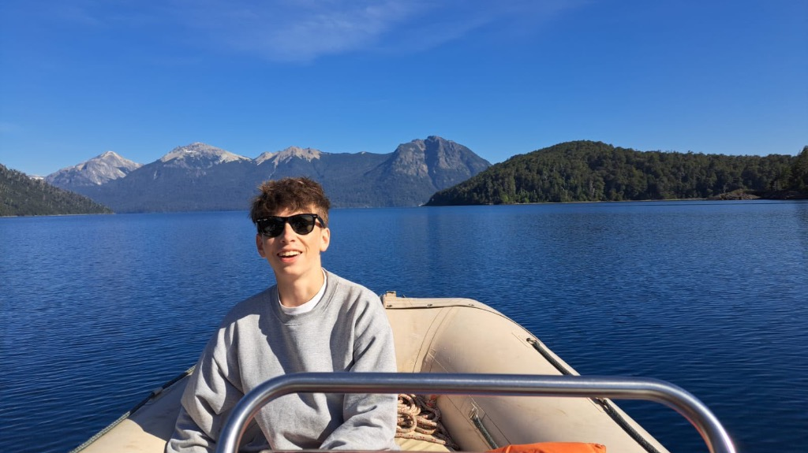

# Batalla Naval Táctica

**Paradigma Orientado a Objetos (3.4.208) · UADE · 2º cuatrimestre 2026 · Lunes turno tarde**

Trabajo práctico grupal: un juego de batalla naval por turnos para dos jugadores, hecho en Java con interfaz gráfica en Swing.

---

## Integrantes

| | Integrante | Legajo | GitHub | Rol en el TP |
| --- | --- | --- | --- | --- |
|  | **Agustín Botana** | 1188651 | [@Botitaa](https://github.com/Botitaa) | Partida y reglas (`GestorPartida`), organización del repo y de Git |
|  | **Marcos Enevoldsen** | 1221035 | [@enevoldsenmar](https://github.com/enevoldsenmar) | Tablero, mapa, navegación y línea de visión; configuración y exportación del historial |
|  | **Santino Faccio** | 1210889 | [@Faccio7L](https://github.com/Faccio7L) | Barcos y combate, guardado de partidas, estadísticas y ranking, UML |
|  | **Bruno Domínguez** | 1213265 | [@Bruno-Dominguez](https://github.com/Bruno-Dominguez) | Vista del tablero en Swing (dibujo, niebla, selección, atajos) e historial |
|  | **Guillermo Sap** | 1206958 | [@guillermosap111](https://github.com/guillermosap111) | Pantallas y flujo del juego en Swing (menús, despliegue, guardado, fin de partida) |

### Agustín Botana

Tengo 20 años, soy de Ezeiza y estudio segundo año de Ingeniería Informática. Me entusiasma aprender buenas prácticas y cómo desarrollar buen software. Me gusta programar videojuegos en mi tiempo libre. Durante este cuatrimestre me gustaría descubrir si Java es tan difícil como dicen; además, me interesan los desafíos difíciles.

### Marcos Enevoldsen

Tengo 20 años, soy de Bariloche y estudio Ingeniería Informática en UADE. Me gustaría especializarme en ciberseguridad. Hincha y socio de River, soy instructor de esquí y me gustaría adquirir conocimientos y experiencia en Java.

### Santino Faccio

Tengo 19 años, soy de Pinamar. Soy estudiante de la Licenciatura en Sistemas en UADE. Busco desarrollarme profesionalmente como desarrollador backend y/o analista funcional. Me gusta mucho el fútbol y soy socio del Club Atlético Independiente.
Mi stack técnico: Python, Java, HTML, CSS, JavaScript y SQL.

### Bruno Domínguez

Tengo 22 años, soy de Cañuelas y estudio la Licenciatura en Gestión de Tecnología de la Información. Me gusta todo lo que tenga que ver con la creación de videojuegos y el desarrollo de personajes. Sé usar HTML, CSS y Python.

### Guillermo Sap

Tengo 20 años, soy de Entre Ríos, vivo en CABA y estudio Ingeniería Informática en UADE. Mi objetivo es crear una marca que provea soluciones de software. Tengo conocimientos básicos de bases de datos SQL y NoSQL.

---

## El proyecto

**Batalla Naval Táctica** es un juego por turnos para dos jugadores en la misma computadora. Toma la batalla naval clásica y le suma mecánicas inspiradas en *World of Warships*: los barcos **se mueven** por el mapa, tienen **rango de disparo** y **visión**, hay **islas y piedras** que bloquean el paso o la vista, y rige la **niebla de guerra**: solo se puede atacar lo que la propia flota ve.

Entre turno y turno aparece una pantalla negra (*blackout*) para que el rival no vea el tablero del otro, y al empezar cada turno el jugador ve un resumen de lo que le pasó.

**Qué incluye:**

- Interfaz gráfica completa en **Swing**: menú principal, nueva partida, despliegue, juego, blackout, resumen del turno, fin de partida, reglas y estadísticas.
- **Guardar y cargar** partidas en archivos de texto, con **autoguardado** al empezar cada turno.
- **Estadísticas** y ranking de jugadores en CSV.
- **Historial** de cada partida, que se puede exportar a `.txt` al terminar.
- **Hilos**: cada pantalla tiene su propio hilo (con una clase abstracta en común), y guardar y cargar corren en un hilo aparte para no congelar la ventana.
- **Configuración** en un archivo `.properties`: últimos nombres usados, autoguardado y carpeta de partidas.
- Casi 700 tests con **JUnit 5**.

**Temas de la materia que se aplican:** clases y objetos, encapsulamiento, herencia (`Barco` → `Destructor`, `Crucero`, `Acorazado`), clases abstractas, interfaces, polimorfismo, `enum`, `record`, colecciones con `Comparator`, excepciones propias, entrada/salida con archivos, GUI con Swing, hilos (`Thread` y `Runnable`), patrones GRASP y principios SOLID.

**Documentación:**

- [Manual de usuario](tp-batalla-naval/docs/MANUAL_USUARIO.md): cómo se juega, controles, guardar y cargar.
- [Diseño de clases](tp-batalla-naval/docs/DISENO_CLASES.md): qué hace cada clase y cada método.
- Diagramas UML (clases, secuencia y estado) en [`tp-batalla-naval/docs/`](tp-batalla-naval/docs/).
- [Prueba manual guiada](tp-batalla-naval/docs/prueba-manual.md) y [guía de entrega](tp-batalla-naval/docs/entrega.md).
- [Cómo trabajamos con Git](tp-batalla-naval/README.md): ramas, PRs y convenciones.

---

## Reglas

### Mapa

Tablero de **10×10**. Cada jugador despliega en sus 3 filas (J1 en las filas 0 a 2, J2 en las filas 7 a 9). Las filas 3 a 6 son zona neutral, donde están los obstáculos. Las 4 casillas del centro, marcadas con borde dorado, son la **zona de dominación**.

| Casilla | Se puede pasar | Bloquea la visión |
| --- | --- | --- |
| Agua | Sí | No |
| Piedra | No | No |
| Isla | No | Sí |
| Restos de un barco hundido | Sí | No |

Los barcos bloquean el paso, pero no la visión ni los disparos. Las distancias se cuentan en casillas y una diagonal cuenta como un solo paso.

### Flota

Cada jugador tiene 6 barcos: **1 Acorazado, 2 Cruceros y 3 Destructores**.

| | Destructor | Crucero | Acorazado |
| --- | --- | --- | --- |
| Vida | 3 | 5 | 8 |
| Daño | 3 | 2 | 4 |
| Rango de disparo | 2 | 3 | 4 |
| Visión | 2 | 4 | 5 |
| Máx. casillas por turno | 4 | 3 | 2 |
| Costo por casilla | 1 | 2 | 3 |
| Espera tras disparar | 0 | 0 | 1 turno |
| Habilidad | Daño doble | Se repara 2 de vida | Rango 6 |

Las habilidades se usan una vez por turno, duran hasta el final del turno y después hay que esperar 3 turnos para volver a usarlas (si se usa en el turno 1, vuelve a estar disponible en el turno 4).

### Turno

- Cada turno hay **6 puntos de movimiento** para toda la flota (no se acumulan).
- Cada barco puede **moverse y después disparar**, las dos cosas son opcionales. Un barco que disparó ya no se puede mover.
- Los disparos **siempre aciertan**, pero solo se le puede disparar a un enemigo visible, dentro del rango y con línea de visión libre.
- Si al moverse un barco se cruza con un enemigo oculto, frena en el paso anterior y el enemigo queda a la vista.

### Niebla de guerra

Se ve una casilla si algún barco propio la tiene dentro de su visión y con línea de visión libre. La visión se comparte entre todos los barcos del jugador y las islas la cortan. El barco que dispara queda visible para el rival durante el turno siguiente, y los barcos que están en la zona de dominación los ven los dos jugadores.

### Cómo se gana

- **Hundimiento:** hundir los 6 barcos rivales.
- **Dominación:** al terminar el turno se suma 1 punto si hay al menos un barco propio en la zona de dominación y ninguno del rival. Con **6 puntos** se gana.
- **Límite de turnos:** a los 40 turnos por jugador gana quien tenga más puntos de dominación. Si empatan, gana quien tenga más barcos vivos, y si siguen empatados, quien tenga más vida total.

Las reglas completas también están dentro del juego (**Inicio → Reglas** o **F1**) y en el [manual de usuario](tp-batalla-naval/docs/MANUAL_USUARIO.md).

---

## Cómo ejecutarlo

### Requisitos

- **Java 25** (JDK para compilar; para correr el jar alcanza con el JRE).
- **Maven**, solo si se compila desde el código fuente.

### Opción 1: correr el jar

Desde la carpeta `tp-batalla-naval/`:

```bash
mvn clean package
java -jar target/batalla-naval-tactica-0.1.0.jar
```

`mvn clean package` corre todos los tests y arma el jar en `target/`. El jar se puede copiar a cualquier computadora con Java 25 y abrir con `java -jar` (o con doble clic).

### Opción 2: desde Maven

```bash
cd tp-batalla-naval
mvn compile exec:java
```

### Opción 3: desde IntelliJ

1. Abrir la carpeta del repo.
2. Clic derecho en `tp-batalla-naval/pom.xml` → **Add as Maven Project**.
3. Correr `batallanaval.app.Main` con el botón verde.

### Tests

```bash
cd tp-batalla-naval
mvn test
```

### Archivos que crea el juego

La primera vez que se abre, el juego crea una carpeta `datos/` en la carpeta desde donde se ejecuta:

| Archivo | Qué guarda |
| --- | --- |
| `datos/config.properties` | Últimos nombres usados, autoguardado sí/no y carpeta de partidas |
| `datos/partidas/*.sav` | Partidas guardadas (incluye `autoguardado.sav`) |
| `datos/estadisticas.csv` | Resultado de cada partida, para el ranking |
| `datos/historiales/*.txt` | Historial completo de cada partida terminada |

---

## Bitácora

Lo que se hizo cada día en el proyecto, armado a partir del historial del repositorio.

**28/09/26:** Definimos la idea y las reglas del juego: una batalla naval por turnos con barcos que se mueven, niebla de guerra y obstáculos.

**05/10/26:** Arrancamos el proyecto:
- Primera versión del diagrama de clases.
- Creamos el proyecto en Java con sus paquetes y una ventana vacía.
- Escribimos el README del TP y las plantillas para tareas y PRs.
- Cargamos todas las tareas del proyecto en GitHub, cada una con su responsable, y armamos el tablero para seguirlas.
- Acordamos cómo trabajar: una rama por tarea y cada cambio revisado por otro integrante antes de entrar.

**06/10 y 08/10/26:** Hicimos los diagramas de secuencia y de estado. Decidimos guardar las partidas en archivos de texto.

**09/10/26:** Definimos cómo se comunica la interfaz gráfica con la partida, y que la partida sea la única que decide qué ve cada jugador. Creamos los errores propios del juego.

**10/10/26:** Definimos dónde se guardan los archivos del juego.

**12/10 al 14/10/26:**
- Primeras clases del modelo: las posiciones del tablero, los tipos de casilla y los barcos.
- Primera versión del tablero en pantalla, que ya reconoce en qué casilla se hace clic.
- Resumen de lo que le pasó a cada jugador en el turno del rival.

**15/10 y 16/10/26:** La clase del jugador, con su flota y sus puntos. La ventana principal y el menú de inicio.

**19/10/26:** El tablero completo, con el mapa estándar y sus obstáculos, la validación del mapa y las zonas de despliegue y de dominación. El tablero se dibuja en pantalla casilla por casilla. Empezamos con el historial de la partida.

**22/10 al 25/10/26:** La primera versión de la clase que maneja la partida. Cálculo de las casillas vecinas y de los movimientos en diagonal.

**26/10/26:** El profesor pidió que cada pantalla tenga su propio hilo de ejecución y sumamos esas tareas. Terminamos el historial de la partida. El tablero muestra el mapa real de la partida.

**27/10/26:** El tablero se actualiza solo cada vez que cambia algo en la partida.

**01/11 al 05/11/26:**
- Pantalla de reglas.
- El tablero dibuja los barcos con su vida, y muestra sus datos al pasar el mouse por encima.
- Primeras partes del guardado de partidas.

**08/11/26:**
- Base para que cada pantalla tenga su propio hilo.
- Niebla de guerra en el tablero.
- Pantalla de nueva partida.
- Estadísticas de los jugadores.
- La partida responde qué barcos hay y cuáles se ven, y registra lo que pasa en el historial.

**09/11 y 10/11/26:**
- Cálculo de qué se ve desde cada barco y de hasta dónde se puede mover.
- Barco seleccionado, casillas a las que puede llegar y ruta con su costo.
- Atajos de teclado.
- Cada pantalla arranca y frena su hilo al mostrarse y ocultarse.
- Pantalla negra entre turnos y resumen del turno.
- Lectura del mapa desde un archivo y ranking de jugadores.

**11/11 y 12/11/26:**
- Pantallas de estadísticas y de juego, con el panel de acciones al costado del tablero.
- Los errores se muestran sin cortar el juego.
- Barra de menú y panel de historial.
- El marcador se actualiza con su propio hilo.

**13/11/26:** Despliegue de los barcos al empezar la partida. Guardar y cargar desde el menú. Manual de usuario.

**14/11/26:** Día de integración, el más largo del proyecto:
- Terminamos las reglas: terminar el turno, mover los barcos, disparar, la niebla de guerra y las habilidades.
- Tests que simulan partidas completas.
- Se armó la aplicación completa uniendo todas las partes.
- Los objetivos se marcan en rojo, con efectos al disparar y al hundir.
- Pantalla de despliegue.
- Guardar y cargar no congelan la ventana.
- Hilo propio en el resto de las pantallas.
- Configuración del juego y exportación del historial.
- Pantalla de fin de partida y guía de prueba manual.

**15/11/26:** Cierre:
- Autoguardado al empezar cada turno.
- La configuración recuerda los últimos nombres usados.
- Tests que faltaban del tablero y del guardado.
- Guía para armar el ejecutable.
- Versión final entregada (`v1.0`).
