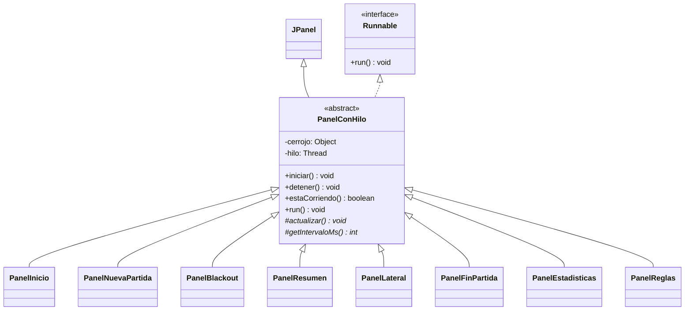

# Batalla Naval Táctica — Diseño de clases

Actualizado: 15 de noviembre de 2026

El juego tiene unos 65 tipos (clases, interfaces, enums y records) repartidos en 7 paquetes. Este documento dice qué hace cada una y sus métodos clave; es el contrato entre módulos y se actualiza junto con el UML.

## Arquitectura

Siete paquetes bajo `batallanaval`, con dependencias en un solo sentido: el modelo no conoce a nadie y la vista solo habla con el contrato de la partida.

| Paquete | Contiene | Puede usar | Responsable |
| --- | --- | --- | --- |
| `modelo` | Posición, casillas, tablero, barcos, jugador | `excepciones` | Marcos (tablero), Santi (barcos), Bota (jugador), Bruno (`ResumenTurno`) |
| `controlador` | Contrato de la partida, `GestorPartida`, fases, observador, vistas de solo lectura e instantánea | `modelo`, `historial`, `excepciones` | Bota |
| `excepciones` | Excepciones propias | nada | Todos |
| `historial` | Historial de partida (eventos que ve el jugador) | `excepciones` | Bruno (`registrarEvento` en `GestorPartida`: Bota) |
| `persistencia` | Guardar y cargar (texto), estadísticas, configuración, mapas desde archivo | `modelo`, `controlador`, `historial`, `excepciones` | Marcos + Santi |
| `vista` | Ventana, pantallas y panel del tablero en Swing | interfaces y records de `controlador`, interfaces de `persistencia`, `excepciones` | Bruno (tablero), Guille (pantallas) |
| `app` | `Main` y armado de la aplicación | todo | Bota |

Reglas que valen para todas las clases:

- Atributos `private`; lo que no cambia, `final`. Colecciones que salen de una clase se devuelven con `List.copyOf` o `Collections.unmodifiableList`.
- La vista nunca recibe un `Barco`, `Jugador` o `Tablero`: recibe `EstadoBarco`, `EstadoJugador` y `Casilla` (inmutables).
- Ninguna clase usa `System.out` para el juego; errores y avisos se muestran en la GUI (barra de estado o diálogo).
- Reglas violadas → excepción de `excepciones` con mensaje para el jugador. Errores de archivo → `PersistenciaException`.
- Lo que se guarda en disco se escribe como texto a través de `InstantaneaPartida`; ninguna clase del modelo es `Serializable`.
- Identificadores en español sin tildes ni ñ (`danio`), constantes en `MAYUSCULAS`.

## modelo — Tablero y mapa (Marcos)

Cuatro clases que saben todo sobre el espacio: dónde se puede pasar, qué se ve y a dónde llega un barco. No saben nada de barcos ni de jugadores.

| Clase | Tipo | Qué hace | Miembros clave |
| --- | --- | --- | --- |
| `Posicion` | Clase `final` inmutable | Una casilla del tablero (fila, columna). Se usa como clave en `Set` y `Map`. | `getFila()`, `getColumna()`, `distanciaChebyshev(Posicion)`, `equals` (castea con `(Posicion) o` después de `instanceof`), `hashCode`, `toString` ("(4,5)") |
| `Casilla` | `enum` | Tipo de casilla con sus propiedades fijas: AGUA, PIEDRA, ISLA, RESTOS. | `bloqueaPaso()`, `bloqueaVision()`, `getSimbolo()`, `static desdeSimbolo(char)` |
| `Tablero` | Clase | Grilla 10x10 de `Casilla`, zonas del mapa y geometría: límites, vecinos, diagonales y línea de visión. Valida el mapa al construirse. | `FILAS`, `COLUMNAS`, `getCasilla(Posicion)` y `getCasilla(int fila, int columna)`, `estaDentro(Posicion)` y `estaDentro(int, int)` (sobrecarga), `esTransitable`, `getVecinos`, `esDiagonalBloqueada`, `hayLineaDeVision` (Bresenham, sin contar extremos), `esZonaDespliegue(pos, numeroJugador)`, `esZonaDominacion`, `convertirEnRestos`, `getRestos()` (casillas convertidas, para guardar) |
| `Navegacion` | Clase utilitaria (constructor privado, métodos `static`) | Calcula a qué casillas puede llegar un barco este turno (BFS). Usa una clase anidada privada `Nodo` (posición y pasos gastados). | `casillasAlcanzables(Tablero, Posicion origen, int pasosMax, Set<Posicion> ocupadas)` |

Decisiones ya tomadas en las reglas: AGUA y RESTOS no bloquean nada, PIEDRA bloquea solo el paso, ISLA bloquea paso y visión. La zona de dominación son las 4 casillas centrales (filas 4–5, columnas 4–5) y siempre es agua. La diagonal entre dos casillas que bloquean también bloquea. El mapa estándar lo lee `LectorMapas` desde `resources/mapas/estandar.txt`; si hay obstáculos fuera de las filas 3 a 6, `Tablero` lanza `MapaInvalidoException`.

## modelo — Barcos (Santi)

Cada barco sabe su vida, sus cooldowns y qué puede hacer este turno; no sabe dónde están los obstáculos ni los enemigos. La partida le pregunta y después le ordena.

| Clase | Tipo | Qué hace | Miembros clave |
| --- | --- | --- | --- |
| `EstadisticasBarco` | `record` | Valores fijos de un tipo de barco. Valida que nada sea negativo. | `vidaMaxima`, `costoMovimiento`, `movimientoMaxPorTurno`, `rangoDisparo`, `vision`, `danio`, `cooldownDisparoMax`, `cooldownHabilidadMax` |
| `Barco` | Clase abstracta | Estado de un barco y reglas propias: daño, curación, cooldowns, movimiento del turno, habilidad (Template Method) y revelado. | Constructores `protected Barco(int id, EstadisticasBarco, Posicion)` y `protected Barco(int id, EstadisticasBarco)`, que llama a `this(id, estadisticas, null)` porque `FabricaFlota` crea los barcos sin posición. `recibirDanio`, `curar`, `estaHundido`, `getDanio`, `getRangoDisparo`, `puedeDisparar`, `registrarDisparo`, `puedeMoverse`, `getCasillasRestantes`, `moverA`, `ubicarEn`, `puedeUsarHabilidad`, `usarHabilidad()` (final), `protected abstract void aplicarHabilidad()`, `reiniciarTurno`, `marcarRevelado`, `estaRevelado`, `abstract char getSimbolo()`, `restaurar(...)` (recibe vida, posición, cooldowns y flags guardados) |
| `Destructor` | Subclase | Vida 3, costo 1, 4 casillas, rango 2, visión 2, daño 3, cooldown 0. Habilidad: daño doble este turno. | `aplicarHabilidad()` activa el flag; `getDanio()` devuelve 6 si está activa. Símbolo `D` |
| `Crucero` | Subclase | Vida 5, costo 2, 3 casillas, rango 3, visión 4, daño 2, cooldown 0. Habilidad: se repara 2. | `aplicarHabilidad()` llama a `curar(2)`. Símbolo `C` |
| `Acorazado` | Subclase | Vida 8, costo 3, 2 casillas, rango 4, visión 5, daño 4, cooldown 1. Habilidad: rango 6 este turno. | `getRangoDisparo()` devuelve 6 si está activa. Símbolo `A` |
| `FabricaFlota` | Clase utilitaria | Crea la flota estándar con ids únicos, así `Jugador` no conoce las subclases (Creador). | `static List<Barco> crearFlotaEstandar(int primerId)`: 1 acorazado, 2 cruceros, 3 destructores, sin posición |

Todas las habilidades tienen espera de 3 turnos, duran hasta el fin del turno, no cuestan puntos y no revelan al barco. Un barco que disparó no puede moverse en ese turno, y queda revelado para el rival durante su turno siguiente.

## modelo — Jugador (Bota)

| Clase | Tipo | Qué hace | Miembros clave |
| --- | --- | --- | --- |
| `Jugador` | Clase | Dueño de una flota de 6 barcos y de sus puntos del turno. Responde preguntas sobre su flota (Experto). | `Jugador(String nombre, int numero, List<Barco> flota)`, `getNombre`, `getNumero` (1 o 2), `getFlota` (no modificable), `getBarcoPorId(int)` (busca en un `Map<Integer, Barco>` interno, lo que usa `disparar(int idObjetivo)`), `getBarcosVivos`, `tieneBarcosVivos`, `getVidaTotal`, `getPuntosMovimiento`, `tienePuntos(int)`, `gastarPuntos(int)`, `reponerPuntos(int)`, `getPuntosDominacion`, `sumarPuntoDominacion`, `getResumen` |
| `ResumenTurno` | Clase | Lo que el rival le hizo al jugador desde su último turno; se muestra al volver del blackout y se limpia. | `agregarDisparoRecibido(Barco objetivo, int danio, Posicion origen)`, `agregarBarcoHundido(Barco, Posicion)`, `getMensajes` (no modificable), `limpiar`, `estaVacio` |

`ResumenTurno` lo implementa Bruno. `Jugador` recibe la flota ya creada por `FabricaFlota` en vez de crearla él: así se puede testear con flotas armadas a mano.

## controlador — Partida y reglas (Bota)

`GestorPartida` es el único lugar donde se aplican las reglas (Controlador GRASP). La vista lo ve a través de cuatro interfaces chicas (ISP) unidas en `Partida`.

| Clase | Tipo | Qué hace | Miembros clave |
| --- | --- | --- | --- |
| `FasePartida` | `enum` | Fase actual. | DESPLIEGUE_J1, DESPLIEGUE_J2, EN_JUEGO, TERMINADA |
| `PartidaDespliegue` | Interfaz | Acciones del despliegue. | `ubicarBarco(int idBarco, Posicion)`, `retirarBarco(int idBarco)`, `getBarcosSinUbicar()`, `confirmarDespliegue()` |
| `PartidaCombate` | Interfaz | Acciones del turno. | `seleccionarBarco(int id)`, `agregarPaso(Posicion)`, `deshacerPaso()`, `confirmarMovimiento()`, `usarHabilidad()`, `disparar(int idObjetivo)`, `terminarTurno()` |
| `PartidaConsulta` | Interfaz | Estado general que leen las pantallas, siempre en objetos inmutables. | `getFase`, `getRonda`, `estaTerminada`, `getResultado()` (`ResultadoPartida`, `null` mientras no termina), `puedeGuardarse()`, `getJugadorActivo()`, `getRival()` (`EstadoJugador`), `getMensajesResumen`, `getHistorialVisible()` |
| `PartidaTablero` | Interfaz | Lo que necesita el panel del tablero para dibujar. Las acciones que dispara con los clics salen de `PartidaDespliegue` y `PartidaCombate`. | `getCasilla(Posicion)`, `esVisible(Posicion)`, `getBarcosPropios()`, `getBarcosEnemigosVisibles()` (`List<EstadoBarco>`), `getBarcoSeleccionado()` (`EstadoBarco`, `null` si no hay selección), `getRutaPlanificada`, `getCostoRuta`, `getCasillasAlcanzables`, `getObjetivosValidos` |
| `Partida` | Interfaz | Une las cuatro; es el tipo que recibe la vista. Cada pantalla puede declarar solo la interfaz que usa (ISP): cada una tiene menos de 12 métodos. Agrega el registro de observadores. | `extends PartidaDespliegue, PartidaCombate, PartidaConsulta, PartidaTablero`; `agregarObservador`, `quitarObservador` |
| `GestorPartida` | Clase | Implementa `Partida`: valida cada acción, la aplica, la anota en el historial y avisa a los observadores. | Constantes `TURNOS_MAX = 40`, `PUNTOS_MOVIMIENTO_TURNO = 6`, `PUNTOS_DOMINACION_VICTORIA = 6`. Atributos: `jugador1`, `jugador2`, `jugadorActivo`, `tablero` (agregación), `fase`, `ronda`, `barcoSeleccionado`, `rutaPlanificada`, `historial`, `resultado`, `accionRealizadaEnTurno`, `List<ObservadorPartida> observadores`. Públicos para guardar: `crearInstantanea()` y `static restaurar(InstantaneaPartida, Tablero)` (la lista de observadores queda vacía; la vista se registra de nuevo; lanza `IllegalStateException` si el estado guardado es imposible). Privados: `iniciarTurno`, `cambiarJugadorActivo`, `esVisibleParaJugador(Jugador, Posicion)`, `esBarcoVisibleParaJugador(Jugador, Barco)`, `actualizarDominacion`, `verificarVictoria`, `resolverLimiteDeTurnos`, `registrarEvento(TipoEvento, String)`, `notificar...`. De paquete (sin modificador, a propósito): `validarEstado()`, que usan `restaurar` y los tests del paquete |
| `InstantaneaPartida`, `DatosJugador`, `DatosBarco` | `record` | Foto completa de una partida para guardarla (Memento): es lo único que ven los repositorios. | `InstantaneaPartida(String mapa, int jugadorActivo, int ronda, FasePartida fase, List<DatosJugador> jugadores, List<DatosBarco> barcos, List<Posicion> restos, List<EventoPartida> eventos)`; `DatosJugador(numero, nombre, puntosMovimiento, puntosDominacion, List<String> resumenPendiente)`; `DatosBarco(id, tipo, jugador, posicion, vida, cooldownDisparo, cooldownHabilidad, casillasRestantes, habilidadActiva, revelado)` |
| `ObservadorPartida` | Interfaz | La implementan la vista y el autoguardado para enterarse de cambios. | `onEstadoCambiado()`, `onFaseCambiada(FasePartida)`, `onTurnoIniciado(String nombreJugador)`, `onPartidaTerminada(ResultadoPartida)` |
| `EstadoBarco` | `record` | Foto de solo lectura de un barco para la vista; la arma `GestorPartida` a partir de `Barco` (el modelo no conoce estos records). | `id`, `numeroJugador` (para el color), `simbolo`, `posicion`, `vida`, `vidaMaxima`, `casillasRestantes`, `cooldownDisparo`, `cooldownHabilidad`, `habilidadActiva`, `rangoDisparo`, `vision`, `esPropio`, `danio`, `costoMovimiento`, `movimientoMaxPorTurno` |
| `EstadoJugador` | `record` | Foto de solo lectura de un jugador. | `nombre`, `numero`, `puntosMovimiento`, `puntosDominacion`, `barcosVivos`, `vidaTotal` |
| `ResultadoPartida` | `record` | Cómo terminó la partida; lo usan la pantalla final y las estadísticas. | `fecha`, `jugador1`, `jugador2`, `ganador` (`null` si empate), `rondas`, `motivo`; `esEmpate()` |
| `MotivoFin` | `enum` | Por qué terminó. | HUNDIMIENTO, DOMINACION, LIMITE_TURNOS, EMPATE, ABANDONO |

### Visibilidad (niebla de guerra)

La regla de qué ve cada jugador vive en **un solo método**: `GestorPartida.esVisibleParaJugador(Jugador observador, Posicion pos)`. Devuelve `true` si la casilla está en la zona de dominación, o si algún barco propio vivo tiene la casilla dentro de su visión (distancia de Chebyshev) y con línea de visión libre. Se eligió `GestorPartida` (Experto) porque es el único que conoce a los dos jugadores y al `Tablero`: `Barco` aporta su visión y su posición, y `Tablero` aporta la geometría (`hayLineaDeVision`, `esZonaDominacion`).

`esBarcoVisibleParaJugador(Jugador, Barco)` delega en el anterior sobre la posición del barco y agrega el caso del barco revelado por disparo. Un barco sin ubicar (despliegue) no lo ve nadie. Todo lo demás llama a estos métodos y no recalcula nada: `esVisible(Posicion)`, `getBarcosEnemigosVisibles`, `getObjetivosValidos`, la validación de `disparar` y el choque con un enemigo oculto al mover. La vista tampoco calcula niebla: `PanelTablero` solo pregunta `esVisible(Posicion)`.

## excepciones

Las de reglas son unchecked: la vista ya deshabilita lo inválido, así que llegar ahí es un error que se muestra en la GUI sin cortar el juego. `PersistenciaException` es checked porque un archivo puede fallar aunque el código esté bien, y el compilador obliga a manejarlo.

| Clase | Extiende | Se lanza cuando |
| --- | --- | --- |
| `AccionInvalidaException` | `RuntimeException` | Base de las de reglas; acción en una fase que no corresponde |
| `DespliegueInvalidoException` | `AccionInvalidaException` | Casilla fuera de zona, ocupada u obstáculo; confirmar sin los 6 |
| `MovimientoInvalidoException` | `AccionInvalidaException` | Paso no adyacente, bloqueado, sin puntos o barco que ya disparó |
| `DisparoInvalidoException` | `AccionInvalidaException` | Objetivo no visible, fuera de rango, sin línea de visión o tirador en cooldown |
| `HabilidadNoDisponibleException` | `AccionInvalidaException` | Habilidad en espera o ya usada este turno |
| `MapaInvalidoException` | `RuntimeException` | Mapa mal formado u obstáculos fuera de la zona neutral |
| `PersistenciaException` | `Exception` | Cualquier error al leer o escribir archivos; envuelve la causa original |

## historial — Historial de partida (Bruno)

El **historial de partida** es parte del juego: lo ve el jugador, se guarda con la partida y se exporta al final. No hay log técnico (`java.util.logging` queda fuera): los errores se muestran en la GUI y las acciones rechazadas no se anotan.

### TipoEvento

`enum` con un atributo que dice si el rival puede verlo; así la niebla de guerra se respeta también en el historial.

```java
public enum TipoEvento {
    DESPLIEGUE(false), MOVIMIENTO(false), HABILIDAD(false),
    DISPARO(true), HUNDIMIENTO(true), DOMINACION(true),
    FIN_TURNO(true), FIN_PARTIDA(true);
    private final boolean publico;
    public boolean esPublico() { ... }
}
```

### EventoPartida

`record` inmutable: una entrada del historial.

```java
public record EventoPartida(int ronda, int numeroJugador, TipoEvento tipo,
                            String descripcion, LocalDateTime momento) {
    public boolean esVisiblePara(int numeroJugador) // tipo.esPublico() || this.numeroJugador == numeroJugador
    public String aLinea()                         // "[R12] J2 DISPARO: Acorazado (7,4) -> Crucero (4,4), -4"
}
```

### HistorialPartida

Clase que guarda los eventos en orden. La crea `GestorPartida` y viaja dentro del guardado.

```java
private final List<EventoPartida> eventos = new ArrayList<>();
public void registrar(EventoPartida evento)          // Objects.requireNonNull(evento)
public List<EventoPartida> getEventos()              // List.copyOf
public List<EventoPartida> getEventosDeRonda(int ronda)
public List<EventoPartida> getEventosVisiblesPara(int numeroJugador)
public int cantidad()
```

**Cómo se conecta:** `GestorPartida` tiene un método privado `registrarEvento(TipoEvento tipo, String descripcion)` que agrega el `EventoPartida` al historial. Cada acción confirmada lo llama una vez. Las acciones rechazadas no van al historial: la vista muestra el mensaje de la excepción.

## persistencia — Archivos (Marcos + Santi)

Se guardan cuatro cosas: la partida (texto), las estadísticas (CSV), la configuración (`.properties`) y el historial exportado (`.txt`); además se lee el mapa (`.txt`). Todo vive bajo `datos/` en la carpeta donde corre el juego, y la vista solo conoce las interfaces `RepositorioPartidas` y `RepositorioEstadisticas` (DIP).

```text
datos/
  config.properties
  estadisticas.csv
  partidas/partida1.sav, autoguardado.sav
  historiales/2026-10-05_1432_Bota-vs-Santi.txt
src/main/resources/mapas/estandar.txt
```

**Reparto:** Marcos hace `RutasApp`, `LectorMapas`, `ConfiguracionJuego` y `ExportadorHistorial`. Santi hace la instantánea (`crearInstantanea`/`restaurar`), los repositorios de partidas y estadísticas, `CabeceraGuardado`, `EstadisticaJugador` y `CalculadoraRanking`.

### RutasApp

Utilitaria con las rutas fijas, para que ningún otro archivo escriba un `"datos/..."` a mano.

```java
public static final Path BASE = Path.of("datos");
public static final Path PARTIDAS = BASE.resolve("partidas");
public static final Path HISTORIALES, ESTADISTICAS, CONFIGURACION;
public static void crearCarpetas() throws PersistenciaException // Files.createDirectories
```

### LectorMapas

Lee un mapa de texto desde los recursos del proyecto y devuelve el `Tablero`. Usa los símbolos de `Casilla` (`~` agua, `I` isla, `P` piedra); las filas de despliegue se escriben como agua.

```java
public static Tablero cargar(String nombreRecurso) throws PersistenciaException
// getResourceAsStream("/mapas/" + nombre) + BufferedReader con try-with-resources.
// 10 líneas de 10 símbolos separados por espacio; si no, PersistenciaException con número de línea.
```

### RepositorioPartidas (interfaz)

```java
void guardar(InstantaneaPartida instantanea, String nombre) throws PersistenciaException; // la copia se arma antes, en el EDT
GestorPartida cargar(String nombre) throws PersistenciaException;
List<CabeceraGuardado> listar() throws PersistenciaException;   // más nuevo primero
void borrar(String nombre) throws PersistenciaException;
boolean existe(String nombre);
```

### CabeceraGuardado

`record` que se escribe como segunda línea del archivo. Permite listar guardados (nombres, ronda, fecha) leyendo solo esa línea y chequear la versión del formato.

```java
public record CabeceraGuardado(int versionFormato, String nombre, LocalDateTime fecha,
        String jugador1, String jugador2, int ronda, FasePartida fase) {}
```

### RepositorioPartidasArchivo

`implements RepositorioPartidas`. Un archivo de **texto** `partidas/<nombre>.sav` por partida, escrito con `BufferedWriter` y leído con `BufferedReader` (try-with-resources), igual que `LectorMapas`. No hay serialización de objetos.

```java
public static final int VERSION_FORMATO = 1;
private final Path carpeta;

// guardar: valida el nombre (letras, números, - y _, hasta 40), exige que la instantánea sea de una
//   partida EN_JUEGO y escribe el archivo. Solo lee la instantánea (nunca el GestorPartida), así que se
//   puede llamar desde un hilo aparte; puedeGuardarse() lo chequea quien arma la instantánea
//   (AccionGuardarPartida, en el EDT). Cualquier IOException -> PersistenciaException.
// cargar: lee línea por línea, chequea la marca y VERSION_FORMATO, arma la InstantaneaPartida,
//   llama a GestorPartida.restaurar(instantanea, tablero), que valida el estado por dentro (validarEstado)
//   y lanza IllegalStateException si es imposible; el repositorio la envuelve en PersistenciaException.
//   Los números se leen con Integer.parseInt y los booleanos con Boolean.parseBoolean.
//   Línea mal formada o NumberFormatException -> PersistenciaException("Línea 14 del guardado inválida"), con la causa original.
// listar: lee solo las dos primeras líneas de cada archivo; uno roto se saltea.
```

**Formato del archivo** (una línea por dato, campos separados por `;`; los nombres de jugador no pueden tener `;`):

```text
BATALLA-NAVAL;1
CABECERA;partida1;2026-10-05T14:32:10;Bota;Santi;12;EN_JUEGO
PARTIDA;estandar;2
JUGADOR;1;Bota;6;1
JUGADOR;2;Santi;6;0
RESUMEN;2;Tu Crucero (4,4) recibió 4 de daño desde (7,4)
BARCO;1;A;1;1;3;8;0;2;2;false;false
BARCO;2;C;1;0;5;5;0;0;3;false;true
RESTOS;5;3
EVENTO;12;2;DISPARO;2026-10-05T14:31:50;Acorazado (7,4) -> Crucero (4,4), -4
```

| Línea | Campos |
| --- | --- |
| `BATALLA-NAVAL` | marca + versión del formato |
| `CABECERA` | nombre, fecha, jugador1, jugador2, ronda, fase (es lo único que lee `listar`; ronda y fase de la partida salen de acá) |
| `PARTIDA` | nombre del mapa (recurso), número del jugador activo |
| `JUGADOR` | número, nombre, puntos de movimiento, puntos de dominación |
| `RESUMEN` | número del jugador, mensaje pendiente (el mensaje es el último campo y puede tener `;`) |
| `BARCO` | id, tipo (`D`/`C`/`A`), jugador, fila, columna, vida, cooldown de disparo, cooldown de habilidad, casillas restantes, habilidad activa, revelado |
| `RESTOS` | fila, columna de cada barco hundido |
| `EVENTO` | ronda, jugador, tipo, momento, descripción (último campo, puede tener `;`; se lee con `split(";", 6)`) |

**Cuándo se puede guardar:** `GestorPartida.puedeGuardarse()` devuelve `true` solo con la partida EN_JUEGO, y únicamente al inicio de un turno (sin acciones realizadas, sin ruta planificada) o en la pantalla de blackout. No se guarda durante el despliegue. Así nunca se guarda un movimiento a medias, y por eso la instantánea no necesita ruta ni barco seleccionado. Después de cargar, la vista se registra de nuevo como observador.

### RepositorioEstadisticas (interfaz) y RepositorioEstadisticasCsv

```java
void registrar(ResultadoPartida resultado) throws PersistenciaException;
List<ResultadoPartida> obtenerTodos() throws PersistenciaException;
```

La implementación CSV usa `;` como separador y una línea de encabezado `fecha;jugador1;jugador2;ganador;rondas;motivo`. `registrar` agrega con `Files.newBufferedWriter(archivo, CREATE, APPEND)` (si el archivo no existía, escribe antes el encabezado). `obtenerTodos` lee con `BufferedReader`; una línea mal formada se saltea y no rompe el resto. Los nombres de jugador no pueden tener `;` (se valida en la pantalla de nueva partida).

### EstadisticaJugador y CalculadoraRanking

```java
public record EstadisticaJugador(String nombre, int jugadas, int ganadas,
                                 int perdidas, int empatadas) {
    public double porcentajeVictorias() // 0 si jugadas == 0; (double) ganadas / jugadas * 100
}

// CalculadoraRanking: agrupa los resultados por jugador en un Map<String, ...>
// y ordena con un Comparator: más ganadas, después mayor porcentaje, después nombre.
public static List<EstadisticaJugador> calcular(List<ResultadoPartida> resultados)
```

Se separa del repositorio para que la regla del ranking se pueda testear sin archivos (SRP).

### ConfiguracionJuego

Envuelve un `java.util.Properties`. Si el archivo no existe o está roto, usa valores por defecto y lo reescribe.

```java
// Claves: jugador1.ultimo, jugador2.ultimo, autoguardado (true), carpeta.partidas
public static ConfiguracionJuego cargar(Path archivo)          // nunca lanza: cae en defaults
public void guardar() throws PersistenciaException
public String getUltimoJugador1() / setUltimoJugador1(String)  // idem jugador 2
public boolean isAutoguardado() / setAutoguardado(boolean)
```

### ExportadorHistorial

Al terminar la partida escribe el historial completo (ya no hay niebla) en `datos/historiales/` con nombre `fecha_hora_J1-vs-J2.txt`.

```java
public static Path exportar(HistorialPartida historial, ResultadoPartida resultado, Path carpeta)
        throws PersistenciaException
// BufferedWriter + try-with-resources: encabezado con jugadores, ganador y motivo,
// después una línea por evento con EventoPartida.aLinea(). Devuelve la ruta creada.
```

## vista — Tablero (Bruno)

El panel dibuja y traduce clics a llamadas a `Partida`; nunca decide si algo es válido.

| Clase | Tipo | Qué hace | Miembros clave |
| --- | --- | --- | --- |
| `PanelTablero` | `extends JPanel implements ObservadorPartida` | Dibuja grilla, casillas, niebla, zona de dominación, barcos con su vida, selección, casillas alcanzables, ruta numerada y objetivos en rojo. Convierte clics en `Posicion` y llama a la partida según el modo. | `PanelTablero(Partida)`, `setModo(ModoInteraccion)`, `setAlClickearCasilla(Consumer<Posicion>)` (qué hace un clic, lo decide quien arma el panel), `setModoDespliegue(boolean)` (sin niebla y sin atajos de combate), `paintComponent(Graphics)`, `posicionEn(Point)`, `onEstadoCambiado()` → `repaint()`. Key bindings: Esc, Backspace, Enter. Tooltip con atributos del barco |
| `ModoInteraccion` | `enum` | Qué significa un clic ahora. | DESPLIEGUE, SELECCION, PLANIFICANDO_RUTA, ELIGIENDO_OBJETIVO, BLOQUEADO |
| `PaletaColores` | Clase utilitaria | Todos los colores en un lugar, según el código visual de las reglas. | `AGUA` azul, `NIEBLA` azul oscuro, `ISLA` verde, `PIEDRA` gris, `RESTOS` X negra, `DOMINACION` borde dorado, `SELECCION` borde amarillo, `RANGO` rojo suave, `RUTA` celeste, `colorJugador(int)` |

## vista — Pantallas y flujo (Guille)

Una sola ventana con `CardLayout`. Cada pantalla es un `JPanel` que recibe lo que necesita por constructor; ninguna crea repositorios ni partidas (eso lo hace `ControladorAplicacion`).

| Clase | Tipo | Qué hace |
| --- | --- | --- |
| `VentanaPrincipal` | `extends JFrame` | Contiene el `CardLayout`, la barra de menú y la barra de estado. `mostrar(Pantalla)`, `mostrarError(String)`, `mostrarMensaje(String)`. Al cambiar de pantalla detiene el hilo de la saliente e inicia el de la entrante si heredan de `PanelConHilo`, y lo detiene también en `windowClosing` y `dispose()`. |
| `Pantalla` | `enum` | INICIO, NUEVA_PARTIDA, DESPLIEGUE, BLACKOUT, RESUMEN, JUEGO, FIN_PARTIDA, ESTADISTICAS, REGLAS, CARGAR. |
| `PanelConHilo` | `abstract extends JPanel implements Runnable` | Base con hilo propio *daemon* (Template Method): `final iniciar()`, `final detener()`, `final estaCorriendo()`, `final run()` y los pasos protegidos `abstract actualizar()` y `abstract getIntervaloMs()`. Sincroniza con un `cerrojo` interno y agenda cada `actualizar()` en el EDT con `SwingUtilities.invokeLater`. |
| `PanelInicio` | `extends PanelConHilo` | Botones Nueva partida, Cargar partida, Estadísticas, Reglas, Salir. Hilo propio: cada 300 ms avanza el barco en la franja de mar y actualiza la hora. |
| `PanelNuevaPartida` | `extends PanelConHilo` | Nombres de J1 y J2 (no vacíos, distintos, sin `;`), precargados de `ConfiguracionJuego`; sorteo de quién es J1. Hilo propio: cada 300 ms refresca la vista previa con los nombres o el error de validación. |
| `PanelDespliegue` | `JPanel implements ObservadorPartida` | `PanelTablero` en modo despliegue (sin niebla ni atajos de combate) a la izquierda; a la derecha la lista de barcos sin ubicar, el barco elegido y los botones Retirar barco y Confirmar despliegue (habilitado solo con los 6 ubicados). Elegir un barco en la lista (o hacer clic sobre uno ya ubicado) y hacer clic en una casilla lo ubica o lo mueve. No valida nada: los rechazos de la partida (`DespliegueInvalidoException`) van a `alError`. `PanelDespliegue(Partida, Consumer<String> alError)`; `actualizar()` se llama al mostrarla para que lea al jugador activo (reemplaza a la pantalla provisoria de `ControladorAplicacion`). |
| `PanelBlackout` | `extends PanelConHilo` | Fondo negro, "Turno de X", botón Listo y botón Guardar partida (solo acá se puede guardar). Hilo propio: cada 600 ms hace parpadear el aviso debajo del cartel. |
| `PanelResumen` | `extends PanelConHilo` | Mensajes de `getMensajesResumen()` y botón Continuar; se saltea si está vacío. Hilo propio: cada 600 ms hace parpadear el aviso junto a Continuar; se inicia y detiene con `HierarchyListener` al mostrarse u ocultarse dentro de su contenedor. |
| `PanelJuego` | `JPanel implements ObservadorPartida` | `PanelTablero` en el centro + `PanelLateral` a la derecha + `PanelHistorial` abajo (plegable). `PanelJuego(Partida, Consumer<String> alError)`; reenvía los avisos de la partida a sus tres paneles (tablero, lateral e historial), así se registra un solo observador. Inicia el hilo de `PanelLateral` cuando la pantalla se muestra y lo detiene cuando se oculta. |
| `PanelLateral` | `extends PanelConHilo implements ObservadorPartida` | Marcador con hilo propio: cada 500 ms `actualizar()` refresca (en el EDT, leyendo solo `PartidaConsulta`) turno, ronda, puntos de movimiento y dominación de ambos; no recalcula reglas. Barco seleccionado (tipo, vida, casillas, cooldowns), puntos de movimiento, dominación de ambos, ronda; botones Confirmar movimiento, Deshacer paso, Usar habilidad, Disparar (con la lista de `getObjetivosValidos()`) y Terminar turno, habilitados según el estado. `PanelLateral(Partida, Consumer<String> alError)`; los rechazos de la partida van a `alError` (barra de estado). |
| `EjecutorAcciones` | Clase utilitaria de paquete | Todos los botones de las pantallas pasan por acá para no cortar el juego. `static boolean ejecutar(Runnable accion, Consumer<String> alError)` y `static ActionListener alTocar(...)`: si la acción lanza `AccionInvalidaException` (o una subclase), muestra su mensaje; si lanza otra `RuntimeException`, muestra "Ocurrió un error inesperado". Los `Error` no se atrapan. |
| `PanelHistorial` | `JPanel implements ObservadorPartida` | `JList<EventoPartida>` con `getHistorialVisible()` (ya filtrado por la partida; el panel no filtra), último evento abajo y visible, cada fila con `aLinea()` y la hora en el tooltip. `PanelHistorial(PartidaConsulta)`, `actualizar()`, `setPlegado(boolean)`/`estaPlegado()`. Con cada aviso rearma la lista entera, porque al cambiar el jugador activo cambia lo que se puede ver. |
| `PanelFinPartida` | `extends PanelConHilo` | Ganador (o "Empate"), motivo explicado y rondas; botones Ver historial (despliega el historial completo en la misma pantalla, sin niebla), Abrir historial exportado (con `Desktop`; deshabilitado si no se pudo exportar) y Volver al inicio. `PanelFinPartida(Runnable alVolverAlInicio, Consumer<String> alError)`; `mostrarResultado(ResultadoPartida, List<EventoPartida>, Path archivoExportado)` antes de mostrarla. Hilo propio: cada 700 ms el título alterna entre dorado y el color normal; lo inicia y detiene `VentanaPrincipal`. |
| `PanelCargarPartida` | `JPanel` | `JTable` con los guardados (`listar()`): nombre, jugadores, ronda, fecha; botones Cargar (también doble clic), Borrar (con confirmación) y Volver. `PanelCargarPartida(VentanaPrincipal, RepositorioPartidas, Consumer<Partida> alCargar)`; `actualizarLista()` se llama cada vez que se muestra. Si el repositorio lanza `PersistenciaException`, su mensaje va a la barra de estado y a un aviso del panel. Cargar corre en una `TareaCargar` (hilo propio): mientras tanto muestra "Cargando partida..." y bloquea los botones. |
| `PanelEstadisticas` | `extends PanelConHilo` | `JTable` con el ranking de `CalculadoraRanking`. Hilo propio: cada 1000 ms actualiza la cantidad de jugadores y la hora. |
| `PanelReglas` | `extends PanelConHilo` | Texto de reglas en un `JScrollPane`. Hilo propio: cada 1000 ms actualiza la hora. |
| `BarraMenuJuego` | `extends JMenuBar implements ObservadorPartida` | Partida → Guardar (Ctrl+S), Cargar (Ctrl+O), Abandonar (con confirmación); Ayuda → Reglas (F1). `BarraMenuJuego(Runnable alGuardar, Runnable alCargar, Runnable alAbandonar, Runnable alVerReglas)`; `mostrarPartida(PartidaConsulta)` (`null` = sin partida) y `actualizar()`. Guardar se habilita solo con `puedeGuardarse()`; Abandonar, con una partida sin terminar; Cargar y Reglas, siempre. La instala `ControladorAplicacion` con `ventana.setJMenuBar(barra)`. |
| `TareaGuardar` | `implements Runnable` | Escribe la partida en un `Thread` propio para no congelar la ventana. `TareaGuardar(RepositorioPartidas, InstantaneaPartida, String nombre, Consumer<String> alGuardar, Consumer<String> alError, Runnable alTerminar)`: recibe la instantánea ya armada en el EDT, no la partida, así el hilo nunca lee una partida que otro está modificando. `run()` hace `try { repositorio.guardar(instantanea, nombre); invokeLater(alGuardar) } catch (PersistenciaException e) { invokeLater(alError con el mensaje) } finally { invokeLater(alTerminar: volver a habilitar los botones) }`; una `RuntimeException` inesperada también va a `alError` (`EjecutorAcciones.MENSAJE_ERROR_INESPERADO`, como `TareaCargar`) y el `finally` corre igual. El hilo propio solo escribe el archivo: todo lo que toca Swing vuelve al EDT con `invokeLater`. |
| `TareaCargar` | `implements Runnable` | Carga en un `Thread` propio. `TareaCargar(RepositorioPartidas, String nombre, Consumer<? super GestorPartida> alCargar, Consumer<String> alError, Runnable alTerminar)`. Mismo esquema `try/catch/finally`: con `invokeLater` entrega la partida a `alCargar` (en la aplicación, `ControladorAplicacion`), o el mensaje a `alError`, y siempre ejecuta `alTerminar`. `PanelCargarPartida` la lanza al tocar Cargar: mientras carga muestra "Cargando partida..." y bloquea Cargar, Borrar y Volver. |
| `AccionGuardarPartida` | `implements Runnable` | Guardar desde la GUI: se conecta al ítem Guardar de `BarraMenuJuego` y al botón de `PanelBlackout`. Si la partida no se puede guardar (`puedeGuardarse()`) muestra el error sin pedir nombre; si se puede, pide el nombre (`JOptionPane`) y pregunta antes de pisar un guardado existente: esos diálogos corren en el EDT. Después arma la `InstantaneaPartida` con `crearInstantanea()`, también en el EDT, y lanza una `TareaGuardar` con esa copia con `new Thread(tarea).start()`; `alEmpezar` (bloquear botones) se ejecuta antes de lanzar y `alTerminar` (liberarlos) al terminar, salga bien o mal. Mientras hay un guardado en curso rechaza otro. Un `PersistenciaException` va a `alError` (barra de estado); si sale bien avisa con `alAviso`. |

### Hilos por pantalla (`PanelConHilo`) y el EDT

Todas las ventanas y componentes de Swing comparten un único hilo (el *Event Dispatch Thread*, o EDT); los hilos propios solo calculan o esperan y le pasan los cambios de la interfaz con `SwingUtilities.invokeLater`.

`PanelConHilo` (`abstract class PanelConHilo extends JPanel implements Runnable`) resuelve con *Template Method* el hilo periódico por pantalla:

- **Estructura común (`final`):** `iniciar()` valida `getIntervaloMs() > 0` y, si no hay un hilo vivo, crea y arranca un `Thread` *daemon* (`"hilo-" + getClass().getSimpleName()`). `detener()` interrumpe ese hilo (`interrupt()`) y limpia la referencia (`hilo = null`), todo sincronizado sobre un `cerrojo` privado. `run()` repite en un bucle `SwingUtilities.invokeLater(this::actualizar)` seguido de `Thread.sleep(getIntervaloMs())` mientras el hilo no sea interrumpido y siga siendo el hilo vigente (`esElHiloVigente()`).
- **Pasos de cada subclase:** cada pantalla concreta solo implementa `protected abstract void actualizar()` (que ya corre dentro del EDT y puede modificar componentes Swing) y `protected abstract int getIntervaloMs()`.
- **Ciclo `iniciar` / `detener` al cambiar de pantalla:**
  - En las pantallas registradas directo en el `CardLayout`, `VentanaPrincipal.mostrar(Pantalla)` detiene primero el hilo de la pantalla saliente (`detenerHiloDeLaPantallaActual()`), cambia la tarjeta visible e inicia el hilo de la pantalla entrante (`iniciarHiloDeLaPantallaActual()`). Al cerrar la ventana (`WindowListener.windowClosing` o `dispose()`), también detiene el hilo activo.
  - En las pantallas armadas dentro de contenedores fijos (`PanelJuego` con `PanelLateral` dentro de `contenedorJuego`, y `PanelResumen` dentro de `contenedorResumen`), un `HierarchyListener` observa `HierarchyEvent.SHOWING_CHANGED`: llama a `iniciar()` cuando `isShowing()` pasa a `true` y a `detener()` cuando pasa a `false`.
- **Hilos de entrada/salida (`TareaGuardar` y `TareaCargar`):** además de los hilos periódicos de `PanelConHilo`, guardar y cargar partidas corren en un `Thread` puntual (`new Thread(tarea).start()`) para no congelar la ventana durante la lectura/escritura en disco, devolviendo el resultado o error al EDT con `SwingUtilities.invokeLater`.



## app — Arranque (Bota)

| Clase | Tipo | Qué hace |
| --- | --- | --- |
| `Main` | Clase con `main` | En orden: `RutasApp.crearCarpetas()` y después `SwingUtilities.invokeLater(() -> new ControladorAplicacion().iniciar())`. |
| `ControladorAplicacion` | Clase | Arma todo (inyección por constructor a mano): carga `ConfiguracionJuego` y crea `RepositorioPartidasArchivo` (en la carpeta de partidas de la configuración), `RepositorioEstadisticasCsv` y `VentanaPrincipal`. Precarga en `PanelNuevaPartida` los últimos nombres de la configuración y los actualiza al comenzar cada partida. Registra un `AutoGuardado` en cada partida y lo quita al soltarla. Crea o carga la partida (con `GestorPartida.restaurar`), registra observadores y decide qué pantalla mostrar según los eventos (`onFaseCambiada`, `onTurnoIniciado`, `onPartidaTerminada`). Al terminar: registra el resultado, exporta el historial con `ExportadorHistorial` en `RutasApp.HISTORIALES` (los eventos salen de `crearInstantanea().eventos()`, una copia completa) y muestra `PanelFinPartida`; si algo de archivos falla, avisa en la barra de estado o en la pantalla de fin y la partida termina igual. |
| `AutoGuardado` | `implements ObservadorPartida` | `AutoGuardado(GestorPartida, RepositorioPartidas, ConfiguracionJuego, Consumer<String> alError)`. Si `autoguardado=true` y `puedeGuardarse()`, en cada `onTurnoIniciado` guarda `autoguardado.sav` (con `crearInstantanea()`, en el mismo hilo del aviso: es un archivo chico y la partida está quieta al empezar el turno). Un fallo se avisa en la barra de estado y no interrumpe la partida. Lo registra `ControladorAplicacion`. |

## Tests (JUnit 5)

Se testea todo lo que no es Swing. Cada autor escribe los tests de sus clases; los de persistencia usan `@TempDir` para no tocar `datos/`.

| Clase de test | Qué verifica | Autor |
| --- | --- | --- |
| `PosicionTest` | Igualdad, `hashCode` en `HashSet`, distancia de Chebyshev | Marcos |
| `TableroTest` | Límites, vecinos, diagonal bloqueada (4 esquinas), línea de visión, zonas, mapa inválido | Marcos |
| `NavegacionTest` | Alcanzables con obstáculos, barcos ocupando casillas y límite de pasos | Marcos |
| `BarcoTest` | Daño y curación en los límites, cooldowns en varios turnos, no moverse tras disparar | Santi |
| `HabilidadesTest` | Las 3 habilidades, su espera de 3 turnos y que duren un solo turno | Santi |
| `JugadorTest` | Puntos, barcos vivos, vida total | Bota |
| `GestorPartidaTest` | Despliegue, turnos, movimiento, disparo, visión compartida, revelado, choque con enemigo oculto, dominación, las 3 victorias y desempates, cada excepción | Bota |
| `HistorialPartidaTest` | Orden de eventos y filtro por jugador sin filtrar información oculta | Bota |
| `RepositorioPartidasArchivoTest` | Guardar y cargar da una instantánea igual; archivo corrupto (con número de línea), de otra versión o inexistente lanza `PersistenciaException`; `listar` saltea archivos rotos | Santi |
| `RepositorioEstadisticasCsvTest` | Append, encabezado una sola vez, líneas rotas salteadas | Santi |
| `CalculadoraRankingTest` | Conteo y orden del ranking, empates | Santi |
| `LectorMapasTest` y `ConfiguracionJuegoTest` | Mapa estándar correcto, mapa mal formado, config faltante cae en defaults | Marcos |

## Pilares del paradigma orientado a objetos

Dónde se aplica cada uno de los cuatro pilares en el proyecto, con las clases y métodos concretos.

| Pilar | Cómo se aplica en el proyecto | Clase y método concretos |
| --- | --- | --- |
| **Abstracción** | Se modelan los conceptos del dominio exponiendo qué hacen sin atar a quien los usa a cómo están implementados, mediante clases abstractas e interfaces. | `Barco` (clase abstracta con el estado y comportamiento común de cualquier navío y los métodos abstractos `aplicarHabilidad()` y `getSimbolo()`); `PanelConHilo` (clase abstracta con el ciclo de vida de un hilo periódico y los pasos abstractos `actualizar()` y `getIntervaloMs()`); interfaces `Partida` (`PartidaDespliegue`, `PartidaCombate`, `PartidaConsulta`, `PartidaTablero`), `ObservadorPartida`, `RepositorioPartidas` y `RepositorioEstadisticas`. |
| **Encapsulamiento** | Todos los atributos son `private` (y `final` cuando no cambian). El estado solo se modifica mediante métodos que validan las invariantes del dominio, las colecciones internas no se exponen nunca como referencias mutables y la vista solo recibe copias inmutables (`EstadoBarco`, `EstadoJugador`, `Casilla`). | `Barco.recibirDanio(int)` y `Barco.curar(int)` mantienen `vida` entre `0` y `vidaMaxima`; `Jugador.gastarPuntos(int)` valida alcance antes de descontar; `Tablero(Casilla[][])` hace copia defensiva de la matriz recibida; `Jugador.getFlota()` e `HistorialPartida.getEventos()` devuelven `List.copyOf(...)`; `GestorPartida.aEstadoBarco(...)` y `aEstadoJugador(...)` construyen records inmutables para que la vista nunca reciba `Barco`, `Jugador` ni `Tablero`. |
| **Herencia** | Las subclases especializan una clase base reutilizando sus atributos, constructores y métodos comunes sin duplicar código. | Jerarquía de barcos: `Barco` → `Destructor`, `Crucero`, `Acorazado`. Jerarquía de excepciones: `RuntimeException` → `AccionInvalidaException` → `DespliegueInvalidoException`, `MovimientoInvalidoException`, `DisparoInvalidoException`, `HabilidadNoDisponibleException`. Jerarquía de pantallas con hilo: `JPanel` → `PanelConHilo` → `PanelInicio`, `PanelNuevaPartida`, `PanelBlackout`, `PanelResumen`, `PanelLateral`, `PanelFinPartida`, `PanelEstadisticas`, `PanelReglas`. |
| **Polimorfismo** | Un mismo mensaje enviado a una referencia del supertipo ejecuta el método propio de la clase concreta en tiempo de ejecución (*dynamic binding*), sin `if` ni `instanceof` por tipo. | `GestorPartida` y `Jugador` operan sobre `List<Barco>`: al llamar a `barco.usarHabilidad()` (que invoca a `aplicarHabilidad()`), `barco.getDanio()`, `barco.getRangoDisparo()` o `barco.getSimbolo()`, responden `Destructor` (duplica daño a 6), `Crucero` (se repara 2) o `Acorazado` (amplía rango a 6). Del mismo modo, `GestorPartida` notifica a `List<ObservadorPartida>` (`PanelJuego`, `PanelDespliegue`, `BarraMenuJuego`, `ControladorAplicacion`, `AutoGuardado`) y la aplicación usa `RepositorioPartidas` sin depender de `RepositorioPartidasArchivo`. |

## Patrones GRASP

| Patrón GRASP | Justificación y decisión de diseño | Clase y método concretos |
| --- | --- | --- |
| **Experto en información** (*Information Expert*) | Cada responsabilidad se asigna a la clase que posee los datos necesarios para cumplirla. | `Barco` (`puedeDisparar()`, `puedeMoverse()`, `puedeUsarHabilidad()`, `estaEnRango(int)`) conoce su vida, sus cooldowns y sus casillas restantes; `Jugador` (`getBarcoPorId(int)`, `getBarcosVivos()`, `tieneBarcosVivos()`, `getVidaTotal()`, `tienePuntos(int)`) conoce su flota y sus puntos; `Tablero` (`estaDentro(...)`, `esTransitable(Posicion)`, `hayLineaDeVision(Posicion, Posicion)`, `esDiagonalBloqueada(...)`, `esZonaDespliegue(...)`, `esZonaDominacion(...)`) conoce la grilla y la geometría; `GestorPartida.esVisibleParaJugador(Jugador, Posicion)` calcula la visibilidad porque es el único que conoce tanto a los jugadores como al `Tablero`. |
| **Creador** (*Creator*) | Crea los objetos quien los agrega, los registra o tiene los datos de inicialización, o bien una fábrica dedicada cuando se busca desacoplar las clases concretas. | `FabricaFlota.crearFlotaEstandar(int primerId)` instancia `1 Acorazado`, `2 Cruceros` y `3 Destructores` para que `Jugador` no dependa de las subclases concretas y pueda testearse con flotas a medida; `GestorPartida` instancia y contiene a `HistorialPartida`, crea cada `EventoPartida` en `registrarEvento(TipoEvento, String)` y construye `InstantaneaPartida` en `crearInstantanea()`; `ControladorAplicacion` crea las pantallas, los repositorios, `AutoGuardado` y las partidas nuevas en `comenzarPartidaNueva()`. |
| **Controlador** (*Controller*) | Un objeto no visual recibe los eventos de la interfaz gráfica y coordina el caso de uso delegando en el modelo. | `GestorPartida` es el controlador de las reglas del dominio: recibe las órdenes de la vista a través de `Partida` (`ubicarBarco`, `seleccionarBarco`, `agregarPaso`, `confirmarMovimiento`, `usarHabilidad`, `disparar`, `terminarTurno`), valida las reglas y coordina a `Jugador`, `Barco`, `Tablero` e `HistorialPartida`. A nivel de aplicación, `ControladorAplicacion` coordina la navegación entre pantallas en `VentanaPrincipal` y los repositorios. |
| **Bajo acoplamiento** (*Low Coupling*) | Las dependencias entre paquetes van en un solo sentido y los módulos se comunican mediante interfaces y records inmutables. | `modelo` solo depende de `excepciones` (no conoce a `controlador`, `persistencia` ni `vista`). `vista` depende únicamente de las interfaces `Partida`, `PartidaDespliegue`, `PartidaCombate`, `PartidaConsulta`, `PartidaTablero`, `ObservadorPartida` y `RepositorioPartidas`, sin importar `Barco`, `Jugador` ni `Tablero`. Los cambios de estado se notifican por `ObservadorPartida` sin que `GestorPartida` conozca a Swing. |
| **Alta cohesión** (*High Cohesion*) | Cada clase tiene un propósito claro y acotado, evitando clases monolíticas que mezclen reglas, algoritmos, archivos e interfaz gráfica. | `Tablero` solo modela la grilla y la línea de visión, mientras que el algoritmo BFS de alcance vive en `Navegacion.casillasAlcanzables(...)`; `CalculadoraRanking.calcular(...)` resuelve el cómputo y ordenamiento del ranking en memoria, separado de `RepositorioEstadisticasCsv` que solo lee y escribe el archivo CSV; `AccionGuardarPartida` resuelve los diálogos en el EDT y delega la escritura en disco en segundo plano a `TareaGuardar`. |

## Principios SOLID

| Principio | Cómo se cumple en el proyecto | Clase concreta de ejemplo |
| --- | --- | --- |
| **S — Single Responsibility Principle** (Responsabilidad única) | Cada clase tiene una única razón para cambiar: las reglas del juego, los algoritmos de búsqueda, el cálculo del ranking, el formato de los archivos y las pantallas Swing están separados en clases distintas. | `CalculadoraRanking` cambia solo si cambia el criterio de puntaje o desempate del ranking; `RepositorioEstadisticasCsv` cambia solo si cambia el formato del archivo `estadisticas.csv`. De igual forma, `ExportadorHistorial` solo formatea y escribe el `.txt` final, y `Navegacion` solo calcula las casillas alcanzables por BFS. |
| **O — Open/Closed Principle** (Abierto a extensión, cerrado a modificación) | Se pueden agregar nuevos comportamientos extendiendo abstracciones o registrando implementaciones, sin modificar el código existente que las usa. | `Barco`: para sumar un nuevo tipo de barco con estadísticas y habilidad propias basta con crear una subclase que implemente `aplicarHabilidad()` y `getSimbolo()`, sin modificar `Jugador` ni `GestorPartida` (como hacen `Destructor`, `Crucero` y `Acorazado`). En `GestorPartida`, agregar un comportamiento al iniciar cada turno (como `AutoGuardado`) se resuelve implementando `ObservadorPartida` y llamando a `agregarObservador(...)`. |
| **L — Liskov Substitution Principle** (Sustitución de Liskov) | Cualquier subtipo puede usarse en lugar de su supertipo manteniendo las precondiciones, postcondiciones e invariantes esperadas por el cliente. | `Destructor`, `Crucero` y `Acorazado` sustituyen a `Barco` en `Jugador` y `GestorPartida`: el método plantilla `public final void usarHabilidad()` en `Barco` asegura que en todos los subtipos se valide `puedeUsarHabilidad()`, se marque `habilidadActiva = true` y se fije `cooldownHabilidad`. Asimismo, `RepositorioPartidasArchivo` y `RepositorioPartidasFalso` (en los tests) son intercambiables detrás de `RepositorioPartidas`. |
| **I — Interface Segregation Principle** (Segregación de interfaces) | Ningún cliente está obligado a depender de métodos que no utiliza: el contrato de la partida se divide en cuatro interfaces chicas (menos de 12 métodos cada una) que luego se reúnen en `Partida`. | `PartidaDespliegue` (4 métodos), `PartidaCombate` (7 métodos), `PartidaConsulta` (10 métodos) y `PartidaTablero` (9 métodos). `PanelHistorial(PartidaConsulta)` y `BarraMenuJuego.mostrarPartida(PartidaConsulta)` reciben solo `PartidaConsulta` porque nunca disparan ni mueven barcos; `PanelTablero(PartidaTablero, PartidaConsulta)` recibe solo las interfaces de dibujo y consulta. |
| **D — Dependency Inversion Principle** (Inversión de dependencias) | Los módulos de alto nivel y la vista no dependen de implementaciones concretas de bajo nivel, sino de interfaces que se inyectan por constructor. | `ControladorAplicacion`, `AutoGuardado`, `PanelCargarPartida`, `AccionGuardarPartida`, `TareaGuardar` y `TareaCargar` dependen de las interfaces `RepositorioPartidas` y `RepositorioEstadisticas` (no de `RepositorioPartidasArchivo` ni `RepositorioEstadisticasCsv`). Las pantallas (`PanelJuego`, `PanelDespliegue`, `PanelLateral`) dependen de la interfaz `Partida`, nunca de `GestorPartida`. |

## Dónde se aplica cada tema de la guía

Tabla de referencia rápida con los temas de la guía de la materia (a partir de la sección 9 del contexto del proyecto) y el lugar real del código donde se aplica cada uno.

| Tema de la guía | Qué muestra en el código | Clase y método reales |
| --- | --- | --- |
| **Sobrecarga de métodos** (*overloading*) | Métodos con el mismo nombre y distinta lista de parámetros; la versión que recibe `Posicion` delega en la que recibe `(int, int)`. | `Tablero.estaDentro(int fila, int columna)` y `Tablero.estaDentro(Posicion posicion)`; `Tablero.getCasilla(int fila, int columna)` y `Tablero.getCasilla(Posicion pos)`. |
| **Sobrecarga de constructores** | Varias formas de construir la misma clase según si se crea desde cero, desde un archivo guardado o desde un test. | `Barco(int, EstadisticasBarco, Posicion)` y `Barco(int, EstadisticasBarco)`; `Jugador` (3 constructores); `RepositorioPartidasArchivo()` y `RepositorioPartidasArchivo(Path)`; `ControladorAplicacion` (4 constructores). |
| **`this()` (encadenamiento de constructores)** | Un constructor delega en otro constructor de la misma clase para no repetir inicializaciones ni validaciones. | `Barco(int id, EstadisticasBarco estadisticas)` llama a `this(id, estadisticas, null)`; `Jugador(int, String, List<Barco>, int, int)` llama a `this(..., List.of())` y este a `this(numero, nombre, flota)`; `RepositorioPartidasArchivo()` llama a `this(RutasApp.PARTIDAS)`; `TareaGuardar` y `TareaCargar` llaman a `this(..., SwingUtilities::invokeLater)`. |
| **`super()` (constructor de la superclase)** | Las subclases invocan al constructor de su clase base en la primera línea. | `Destructor(int, Posicion)`, `Crucero(int, Posicion)` y `Acorazado(int, Posicion)` llaman a `super(id, ESTADISTICAS, posicion)`; `PersistenciaException(String, Throwable)` llama a `super(mensaje, causa)`. |
| **Clases envolventes (*wrappers*) y *autoboxing*** | Uso de tipos objeto (`Integer`, `Boolean`) en colecciones genéricas y métodos estáticos de conversión desde `String`. | `Map<Integer, Barco> barcosPorId` en `Jugador.getBarcoPorId(int)`; `Integer.parseInt(...)` y `Boolean.parseBoolean(...)` en `RepositorioPartidasArchivo.cargar(String)`, `RepositorioPartidasArchivo.listar()` y `ConfiguracionJuego`. |
| **Casteo (*casting*) de referencia y primitivo** | Conversión explícita de `Object` luego de comprobar `instanceof`, y conversión a `double` para evitar división entera. | `Posicion.equals(Object obj)` comprueba `if (!(obj instanceof Posicion))` y castea con `Posicion otra = (Posicion) obj`; `EstadisticaJugador.porcentajeVictorias()` hace `(double) ganadas / jugadas * 100.0`. |
| **Acceso de paquete (*package-private*)** | Miembros y clases sin modificador de visibilidad a propósito, accesibles solo dentro del mismo paquete (y por sus tests). | `GestorPartida.validarEstado()` en `batallanaval.controlador`; clase `EjecutorAcciones` en `batallanaval.vista`; constructores de prueba en `ControladorAplicacion`, `TareaGuardar` y `TareaCargar`; `PanelConHilo.getHilo()` y `PanelDespliegue.alClickearCasilla(Posicion)`. |
| **Bloque `finally`** | Código de limpieza o desbloqueo que se ejecuta siempre, haya salido bien el `try` o se haya lanzado una excepción. | `TareaGuardar.run()` y `TareaCargar.run()` ejecutan `finally { enElEdt.execute(alTerminar); }` para volver a habilitar los botones de la pantalla aunque falle la lectura o escritura; `PanelDespliegue.actualizar()` restablece `actualizando = false` en un `finally`. |
| **Destructores y *Garbage Collector*** | En Java no hay destructores manuales (`finalize()` está obsoleto): la memoria la reclama el *Garbage Collector* al soltar referencias, y los recursos del sistema operativo se cierran de forma determinística con `try-with-resources`. | Liberación de referencias en `ControladorAplicacion.soltarPartida()` (`quitarObservador(...)` y `partida = null`) y en `PanelConHilo.detener()` (`hilo.interrupt(); hilo = null;`). Cierre determinístico de archivos con `try (BufferedReader ...)` y `try (BufferedWriter ...)` en `RepositorioPartidasArchivo`, `LectorMapas`, `RepositorioEstadisticasCsv`, `ConfiguracionJuego` y `ExportadorHistorial`. |
| **Inmutabilidad y copia defensiva** | Objetos cuyo estado no puede cambiar tras construirse, y copias al recibir o devolver estructuras mutables. | `Posicion` (`final class`, atributos `private final int fila, columna`); `Tablero(Casilla[][])` copia la matriz celda por celda; `Jugador(int, String, List<Barco>)`, `Jugador.getFlota()` e `HistorialPartida.getEventos()` usan `List.copyOf(...)`. |
| **`equals`, `hashCode` y `toString`** | Redefinición coherente de igualdad por valor y código hash para usar objetos como clave en `HashSet` y `HashMap`. | `Posicion.equals(Object)`, `Posicion.hashCode()` (`31 * fila + columna`) y `Posicion.toString()` (`"(fila,columna)"`), usada en `Set<Posicion>` dentro de `Navegacion.casillasAlcanzables(...)`. |
| **Miembros `static` y clases utilitarias** | Constantes de clase y métodos sin estado agrupados en clases `final` con constructor `private`. | `Navegacion.casillasAlcanzables(...)`, `FabricaFlota.crearFlotaEstandar(int)`, `RutasApp.crearCarpetas()`, `LectorMapas.cargar(String)`, `CalculadoraRanking.calcular(List)`, `ExportadorHistorial.exportar(...)`, `PaletaColores`. |
| **Clases anidadas privadas** | Tipos auxiliares encapsulados dentro de la única clase que los necesita. | `Navegacion.Nodo` (posición y pasos gastados en el BFS), `CalculadoraRanking.Acumulador`, `RepositorioPartidasArchivo.DatosJugadorAux`, `PanelDespliegue.RenderizadorBarcos`. |
| **`enum` con atributos y métodos** | Enumerados que encapsulan propiedades y comportamiento propio de cada constante. | `Casilla` (`bloqueaPaso()`, `bloqueaVision()`, `getSimbolo()`, `static desdeSimbolo(char)`) y `TipoEvento` (`private final boolean publico`, `esPublico()`). |
| **`record` y constructor compacto** | Portadores de datos inmutables para transferencia entre capas, eventos, instantáneas y estadísticas. | `EstadisticasBarco` (con constructor compacto que valida que ningún valor sea negativo), `EstadoBarco`, `EstadoJugador`, `ResultadoPartida`, `EventoPartida`, `InstantaneaPartida`, `DatosJugador`, `DatosBarco`, `CabeceraGuardado`, `EstadisticaJugador`. |
| **Método plantilla (*Template Method*) y `final`** | Un método `final` en la clase abstracta fija los pasos del algoritmo e invoca pasos `abstract` que completan las subclases. | `Barco.usarHabilidad()` (`final`) valida disponibilidad, activa el flag, llama a `protected abstract void aplicarHabilidad()` y fija el cooldown; `PanelConHilo.iniciar()`/`run()`/`detener()` (`final`) manejan el hilo e invocan `protected abstract void actualizar()` y `getIntervaloMs()`. |
| **Colecciones (`List`, `Set`, `Map`) y `Comparator`** | Uso de estructuras de datos de `java.util` y criterios de ordenamiento compuestos. | `List<Barco>` y `Map<Integer, Barco>` en `Jugador`; `Set<Posicion>` en `Navegacion.casillasAlcanzables(...)`; `Map<String, Acumulador>` y `Comparator.comparingInt(EstadisticaJugador::ganadas).reversed().thenComparing(...)` en `CalculadoraRanking.calcular(...)`; `cabeceras.sort((c1, c2) -> c2.fecha().compareTo(c1.fecha()))` en `RepositorioPartidasArchivo.listar()`. |
| **Excepciones propias (*checked* y *unchecked*)** | Separación entre errores de entrada/salida recuperables (*checked*, con causa encadenada) y violaciones de reglas del dominio (*unchecked*). | `PersistenciaException extends Exception` (*checked*, envuelve `IOException`/`NumberFormatException` con `super(mensaje, causa)`); `AccionInvalidaException extends RuntimeException` y sus subclases (`DespliegueInvalidoException`, `MovimientoInvalidoException`, `DisparoInvalidoException`, `HabilidadNoDisponibleException`), más `MapaInvalidoException`. |
| **Entrada/Salida con flujos y `Properties`** | Lectura y escritura de archivos de texto línea por línea en UTF-8 y configuración clave-valor. | `BufferedReader` y `BufferedWriter` con `Files.newBufferedReader`/`newBufferedWriter` en `RepositorioPartidasArchivo`, `RepositorioEstadisticasCsv` y `ExportadorHistorial`; `getResourceAsStream` + `InputStreamReader` en `LectorMapas.cargar(String)`; `java.util.Properties` en `ConfiguracionJuego`. |
| **Concurrencia e hilos (`Thread`, `Runnable`, EDT)** | Hilos de fondo para no bloquear la ventana al acceder al disco y un hilo por pantalla para animar o refrescar la vista; todas las ventanas comparten el EDT de Swing y los hilos propios solo calculan/esperan y pasan los cambios con `invokeLater`. | `PanelConHilo` (un hilo por pantalla: `extends JPanel implements Runnable`, con `synchronized (cerrojo)`, `Thread.sleep`, `Thread.interrupt()`, `SwingUtilities.invokeLater(this::actualizar)` e `iniciar()`/`detener()` al cambiar de pantalla) + `TareaGuardar` y `TareaCargar` (`implements Runnable`, lanzadas con `new Thread(tarea).start()` desde `AccionGuardarPartida` y `PanelCargarPartida`). |